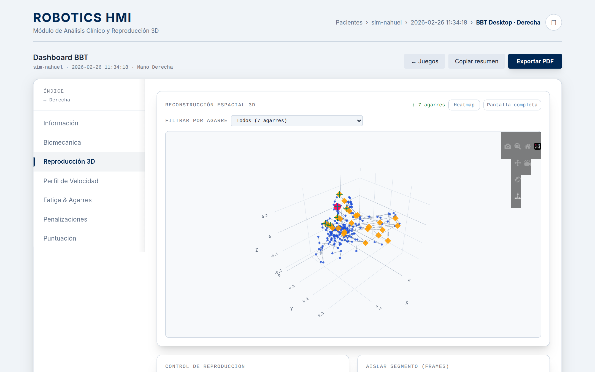
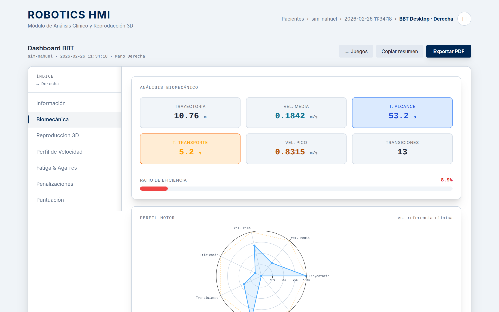
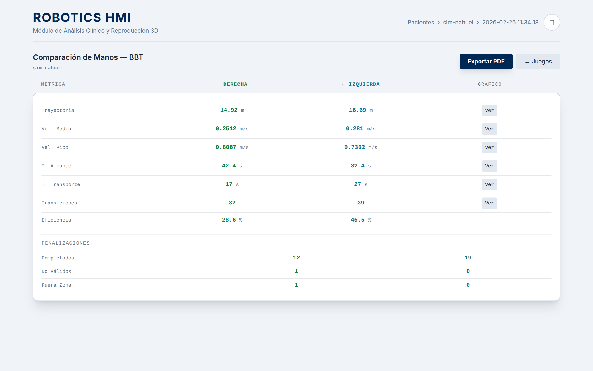
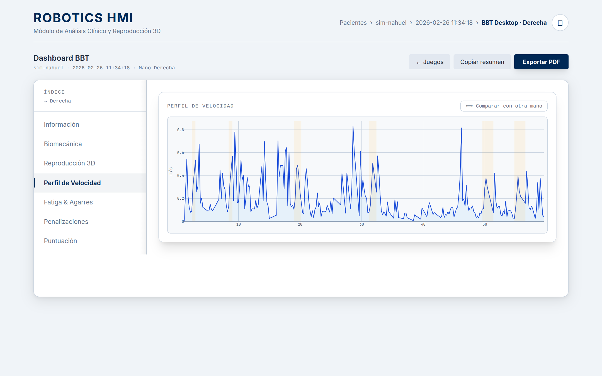
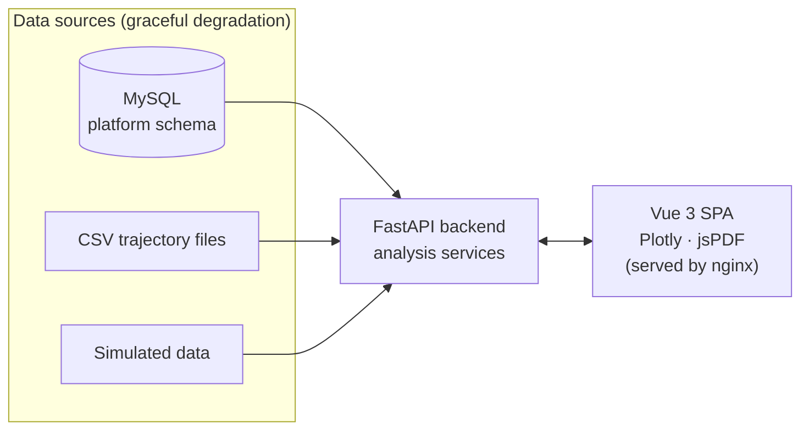

# Clinical Dashboard for Robot-Assisted Rehabilitation

**A web dashboard that turns the raw data of upper-limb rehabilitation games into biomechanical metrics a therapist can read: 3D trajectory replay, speed profiles, fatigue, bilateral asymmetry and dysmetria.**

Bachelor's Thesis (TFG) · BSc in Computer Science and Engineering · Universidad Carlos III de Madrid · 2025–2026

<p align="center">
  
  
  
  
</p>

<p align="center"><sub>Screenshots of the sample patient <code>sim-nahuel</code>, running without a database.</sub></p>

## The problem

The rehabilitation platform at UC3M runs therapy games, such as the **Box and Blocks Test** and **Fruits**, on a desktop setup and in VR (Meta Quest). Every session records the 3D position of the hand several times per second, plus scores and timings. That raw telemetry isn't something a therapist can act on: what they need is how far and how fast the patient moved, how efficiently, whether they got tired, and whether one side performs worse than the other.

## The solution

A web dashboard for a local clinical workstation that reads that data and presents it as interpretable metrics:

- **Biomechanics per hand:** trajectory length, mean and peak speed, reach and transport time, transitions, an efficiency ratio, and a motor profile radar compared against a clinical reference.
- **3D reconstruction and replay** of the hand trajectory. You can filter by grasp, show a heatmap, isolate a segment of frames and replay it.
- **Velocity profile** over the session, with the grasp intervals highlighted.
- **Fatigue index** across the session and **bilateral asymmetry** alerts, with a side-by-side right vs. left comparison.
- **Session history and evolution** per patient, with date filters.
- **PDF report export** and a "copy summary" button for clinical notes.
- **Offline by design:** the frontend has no build step and serves its libraries locally, so the dashboard works on a workstation with no internet access.

## Architecture



- **Backend (FastAPI):** routers per domain (patients, BBT, Fruits, CSV) and analysis services that compute the metrics from the raw trajectories.
- **Degradation chain:** the API reads from the platform's MySQL database when it is available. If not, it reads the CSV files the games write to disk, and as a last resort it serves a simulated data set.
- **Frontend:** a Vue 3 single-page app with no build chain, Plotly for the 3D and time-series charts, and jsPDF for reports. All libraries are self-hosted in `frontend/vendor/`.
- **Deployment:** Docker Compose with MySQL, Flyway migrations, the API and nginx.

## Verification with synthetic patients

No real patient data could be used, so I built a **generator of clinically motivated synthetic patients** (`scripts/seed_synthetic_patients.py`). It does not inject the expected metric values. Instead, it translates documented motor mechanisms into movement-generation parameters: cerebellar dysmetria, spasticity, spatial neglect and fatigability. The metrics then emerge from the synthesized trajectory.

- Each patient comes from a JSON recipe with a fixed seed (`scripts/presets/`), so the result is exactly reproducible.
- `--verify` queries the API and checks that the dashboard detects what was injected. This loop found a real bug that neither the unit tests nor manual inspection had caught.
- `scripts/bench/` measures the scaling of the analysis layer, API latency and 3D viewer performance, and runs a **sensitivity sweep** over the clinical thresholds.
- The backend has 34 automated tests, which run in GitHub Actions on every push.

The clinical validation of the thresholds would require real patients, and the thesis states it explicitly as future work.

## Running it

Requirements: Docker with Docker Compose.

```bash
cp .env.example .env
docker compose up -d --build api frontend
```

- Dashboard: http://localhost
- Interactive API docs: http://localhost:8000/docs

This starts the dashboard **without a database**. It reads the sample patient in `backend/Patients/` (`sim-nahuel`, one desktop and one VR session) and falls back to simulated data for the rest.

> **About the database.** The full mode runs on the shared database of the department's rehabilitation platform. The dashboard consumes that schema; it didn't create it. The schema isn't included in this repository, so `db/flyway/` only contains the incremental migrations on top of it. To use the full mode and the synthetic patient generator, you need access to that platform schema.

Tests:

```bash
cd backend && pip install -r requirements-dev.txt && python -m pytest -q
```

## Tech stack

| Layer | Technologies |
|---|---|
| Backend | Python 3.12, FastAPI, Pydantic, SQLAlchemy, PyMySQL |
| Frontend | Vue 3 (no build step), Plotly.js, jsPDF, Tailwind CSS |
| Data | MySQL 8, Flyway, CSV telemetry from the rehabilitation games |
| Infra | Docker Compose, nginx, GitHub Actions |

## Context

- **Thesis:** *Programación de Interfaz Web para generación de reportes clínicos para terapias asistidas por robot* (web interface for generating clinical reports for robot-assisted therapies). The full report, in Spanish, is in [`20260907_tfg_panel_clinico.pdf`](20260907_tfg_panel_clinico.pdf).
- **Individual project**, supervised by a tutor from the department that runs the rehabilitation platform.
- **Data:** this public copy contains no patient data. The only sample, `sim-nahuel`, is a single test recording under a neutral name. The original test files were removed from the history.

## License

All rights reserved, except for the use granted to Universidad Carlos III de Madrid for teaching and research (see [`LICENSE`](LICENSE), in Spanish). The libraries in `frontend/vendor/` and the fonts in `frontend/css/fonts/` keep their own licenses.
